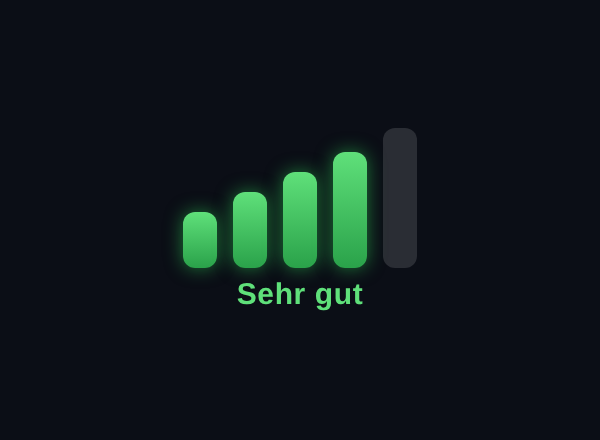

# MMM-WifiLink

A [MagicMirror²](https://magicmirror.builders/) module that shows a clean, **iOS-style Wi-Fi
signal indicator**: five bars that light up and change colour with the real link quality
(green → amber → red). The signal is read directly from `iw` (actual dBm), and the display
updates **in place** so it never flickers.



## Features

- Five signal bars, coloured by quality (excellent/good → fair → weak)
- Real signal strength (dBm) from `iw dev <iface> link`
- Optional quality label under the bars (localised; English & German included)
- In-place DOM updates — no black flicker on refresh
- Two sizes (`normal` / `small`) and self-contained styling

## Requirements

- **Linux** with a wireless interface
- The `iw` tool (`sudo apt install iw`)
- Read access to `/proc/net/dev` (default)

## Installation

```bash
cd ~/MagicMirror/modules
git clone https://github.com/ago1776/MMM-WifiLink
```

Then add the module to `config/config.js`:

```js
{
  module: "MMM-WifiLink",
  position: "top_right",
  header: "Wi-Fi",           // optional
  config: {
    iface: "wlan0"
  }
}
```

## Configuration options

| Option           | Type    | Default   | Description                                        |
| ---------------- | ------- | --------- | -------------------------------------------------- |
| `iface`          | string  | `"wlan0"` | Wireless interface to read.                        |
| `updateInterval` | number  | `5000`    | Poll interval in ms.                               |
| `showLabel`      | boolean | `true`    | Show the quality word under the bars.              |
| `barSize`        | string  | `"normal"`| Bar size: `"normal"` or `"small"`.                 |

## Translations

Quality words live in `translations/en.json` and `translations/de.json`. Add a language by
copying `en.json` to `<lang>.json` and translating the values. Language follows MagicMirror's
global `language` setting.

## License

MIT © Andreas Göpfert

